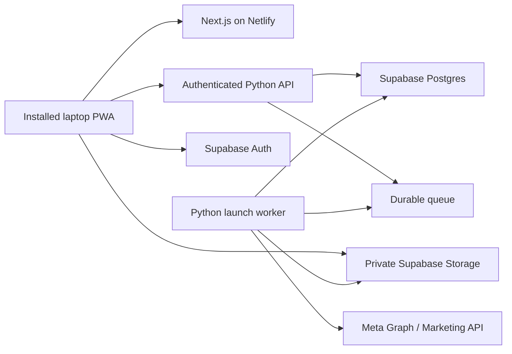

# Monz MTL Launchpad: hosting and laptop PWA readiness

Prepared: November 1, 2026  
Repository baseline reviewed: `main`, commit `f87fd57`  
Status: decision report and implementation brief; no infrastructure has been provisioned.

## Recommendation

Host the Next.js interface on **Netlify**, use **Supabase for authentication, database, private media storage and a durable queue**, and run the existing **Python API and launch worker on a separate container-capable host**.

Start with a private, invite-only workspace. Keep the Python campaign logic. Make jobs persistent before treating the application as production-ready. Add laptop installation and a limited offline experience without attempting to run Meta campaign creation offline.

Netlify plus Supabase is useful, but the existing Python launcher is not a direct deployment to their function runtimes. A separate Python service avoids a substantial rewrite into short, resumable function invocations.

## Current application assessment

| Area | Current implementation | Hosting implication |
| --- | --- | --- |
| Frontend | Next.js 15 App Router, React, TypeScript | Suitable for Netlify's Next.js adapter. |
| Backend | FastAPI and Python Meta API client | Package as a separate container/service. |
| Media | Multipart uploads, temporary directories, folder/ZIP parsing | Use private object storage and preserve relative paths. |
| Jobs | In-memory `_JOBS`, daemon threads | Jobs and logs disappear on restart; replace with durable state and a worker. |
| Upload registry | In-memory `_UPLOADS` | Other API processes cannot find uploads; persist metadata. |
| Asset selection | Backend-local `.meta-assets.json` | Move to workspace-scoped database records in hosted mode. |
| Meta credentials | Backend environment / `.env` | Suitable for a single trusted workspace initially; introduce server-only encrypted connection records for multiple workspaces. |
| Presets | Browser `localStorage` | Move to database for synchronization; migrate existing presets deliberately. |
| Video transfer | Separate 600-second socket inactivity timeout | Launches must outlive an HTTP request; timeout is not a total job duration limit. |
| Access control | No application login or workspace ownership enforcement | Must be implemented before exposing launch/configuration endpoints publicly. CORS does not provide authentication. |
| PWA | No manifest or service worker | Add install metadata, icons, service worker and update/offline UX. |

Relevant source: `app/`, `lib/backend.ts`, `components/copy-presets/CopyPresetsContext.tsx`, `launcher/backend.py`, `launcher/config.py`, `launcher/meta_api.py`, and `launcher/launch_core.py`.

## Proposed architecture



The frontend sends small API requests directly to the authenticated Python API over HTTPS. Large files go directly to private Storage through an authenticated resumable upload flow. The API validates ownership and queues work only after the upload is complete. The worker downloads a job's media to temporary scratch space, runs the Python launcher, and persists progress and Meta object IDs.

A short API request returns a job ID. The PWA restores that job from the database when reopened and polls its status initially; realtime updates can follow later. The queue needs atomic claims, leases/visibility timeouts, heartbeat renewal and bounded retries. A worker crash must be distinguishable from a normal long video-processing delay.

The API and worker can share a container image, launched with different commands. Redis is not inherently required if a Supabase/Postgres-backed queue is selected. Supabase Queues is one candidate; verify its delivery and lease behavior against the worker implementation before choosing it. [Supabase Queues](https://supabase.com/docs/guides/queues)

## Platform feasibility and constraints

| Platform | Appropriate role | Constraint affecting this application |
| --- | --- | --- |
| Netlify | Next.js interface, HTTPS and deployment previews | Ordinary Functions have finite request duration and body size limits. Do not proxy videos or run an entire launch inside a frontend request. |
| Supabase Database / Auth | Workspace identity, selections, presets, jobs and logs | Define ownership and authorization before browser access. A privileged server key must never enter the client bundle. |
| Supabase Storage | Private source media, resumable transfers | Configure file limits, retention, object ownership and bandwidth budget. |
| Supabase Edge Functions | Small orchestration operations if useful | Not the recommended runtime for the existing Python launcher and lengthy video operations. |
| Python container host | API and worker | Needs sufficient memory, temporary disk, outbound access to Meta, restart handling and controlled concurrency. |

As checked for this report, Netlify documents a **60-second synchronous execution limit**, **15-minute background limit**, and **6 MB buffered request/response limit**; binary request encoding reduces the effective upload allowance. These are function limits, not a limit on static pages or direct browser-to-storage transfers. [Netlify function configuration](https://docs.netlify.com/build/functions/configuration/)

Supabase documents Edge Function worker wall-clock limits of **150 seconds on Free and 400 seconds on paid plans**, with separate memory and CPU limits. Moving work into a background handler does not remove that runtime ceiling. [Supabase Edge Function limits](https://supabase.com/docs/guides/functions/limits)

Supabase Storage Free projects have a **50 MB maximum per file**. Paid plans permit a higher configured limit. Resumable uploads are recommended for files above 6 MB or unreliable connections. These resumable transfers solve the laptop-to-Storage leg; the worker-to-Meta transfer still needs its own timeout/recovery strategy. [Storage file limits](https://supabase.com/docs/guides/storage/uploads/file-limits), [Resumable uploads](https://supabase.com/docs/guides/storage/uploads/resumable-uploads)

Netlify supports current Next.js applications through its adapter. Validate the project's actual Next.js version and current adapter behavior when implementation begins. [Next.js on Netlify](https://docs.netlify.com/build/frameworks/framework-setup-guides/nextjs/overview/)

## Data, media and credentials

Suggested records, subject to schema design:

- `workspaces` and `workspace_members`: account boundary and member roles.
- `meta_connections`: server-only connection references or encrypted tokens, expiry metadata and granted permissions.
- `asset_selections`: selected business, ad account, Page, Instagram and pixel IDs per workspace.
- `copy_presets`: synchronized presets with explicit migration from browser storage.
- `uploads` and `upload_files`: ownership, status, object keys, file sizes and original relative paths.
- `launch_jobs` and `job_events`: immutable launch inputs, execution state and ordered logs.
- `launch_objects`: Meta campaign/ad-set/creative/ad/video IDs and completed-step checkpoints.

Browser database and Storage access must enforce workspace ownership through row-level/storage policies. The Python API must independently verify the caller's identity and membership before using privileged credentials. Another user's job or upload ID must not grant access.

Preserve relative paths in metadata even if object keys use generated IDs. The existing parser uses folder structure to distinguish ad sets and carousels. Validate archive paths, file counts, individual sizes and expanded ZIP size before processing. Configure cleanup so queued/running jobs retain their media until a terminal state and the retention period have elapsed.

Initially, an operator-controlled Meta token can remain a backend secret for one workspace. A later multi-business product should use an appropriate Meta connection/OAuth flow and verify the required permissions and app access levels. Supabase login and Meta asset authorization are separate concerns.

Job retries require special care: database transactions cannot make an external Meta write exactly-once. Persist checkpoints, reconcile ambiguous responses, and require review when a timed-out write may have succeeded. Do not automatically rerun a whole campaign after an uncertain upload or ad-creation response.

## Laptop PWA scope

The PWA is the hosted web interface installed in a standalone laptop window. Once the backend is hosted, users do not need to run Python locally.

| Capability | Initial target |
| --- | --- |
| Installation | Manifest, name, icons, HTTPS and standalone display; test target Chrome/Edge and macOS Safari flows. |
| Offline opening | Cached shell or a clear offline fallback. |
| Drafts | Local drafts, with account-aware synchronization after authentication is implemented. |
| Launching | Online only, with explicit user confirmation. |
| Closing the window | Accepted server jobs continue; reopening restores status and logs. |
| Laptop sleep during upload | Upload may pause; resume when the app returns. Do not claim background upload completion. |
| Notifications | Optional later phase, with permission and server-side push delivery. |
| Updates | Notify users about a new version; preserve drafts and avoid forced reload during uploads. |

A service worker should cache selected public static assets only at first. Do not cache tokens, authenticated API responses, media, or launch requests. Never automatically replay launch POST requests after reconnecting: that can duplicate advertising objects.

Installation behavior varies by browser; a custom install button needs a fallback. Service workers do not guarantee continuous execution during sleep or after closing the app. A manifest and HTTPS support installation; the service worker provides the chosen offline behavior. [Next.js PWA guide](https://nextjs.org/docs/app/guides/progressive-web-apps), [MDN installation guide](https://developer.mozilla.org/en-US/docs/Web/Progressive_web_apps/Guides/Making_PWAs_installable)

## Rollout plan and completion gates

| Phase | Scope | Completion gate |
| --- | --- | --- |
| 1 — Local hosting/PWA foundation | Explicit runtime configuration, reproducible Python/container setup, Netlify build configuration, installable PWA shell and offline fallback | Local workflows still pass; container health works; PWA installs; API writes stay network-only. No public backend deployment. |
| 2 — Identity and persistent state | Supabase local schema/migrations, invite-only login, workspace policies, settings/preset migration, private Storage and resumable uploads | Unauthorized and cross-workspace access tests pass; uploads survive API restart; secrets stay server-only. |
| 3 — Durable launch execution | Separate worker, durable queue, persistent logs/checkpoints, job restoration and recovery controls | Worker/API restart tests pass; retries do not silently duplicate ads; completed uploads can be launched after the laptop disconnects. |
| 4 — Hosted private pilot | Provision approved services, configure HTTPS/domains/secrets, deploy staging, then invite-only production | End-to-end upload/preview/confirmed launch succeeds; operational limits, backups, retention and rollback are documented. |
| 5 — Product expansion | Multi-workspace Meta connections, richer sync, notifications and scaling | Validate against actual user demand and Meta requirements. |

PWA installation may be demonstrated in Phase 1, but reliable jobs continuing after the window closes depends on Phase 3. Phase 1 scaffolding is not authorization to publish an unauthenticated launch backend.

## Cost and decision points

Supabase Pro starts at **US$25/month** as checked for this report. Add Netlify usage, Python service/worker hosting, and any storage/egress overages. This is not an all-in quote. Recheck current limits, currencies, taxes and pricing before purchase. [Supabase pricing](https://supabase.com/pricing)

For video-heavy use, budget from measured GB uploaded, GB read by workers, retention duration and repeated launches. Source media may travel laptop → Storage → worker → Meta. Avoid routing video bodies through Netlify Functions. A shared API/worker container can reduce a pilot's host count, but durable jobs and a worker execution boundary are still required.

Decide before the hosted pilot:

- Who needs access: one operator, an internal team, or external customers?
- Which Python host and region should sit near the database/storage?
- What are the largest files, daily upload volume, peak concurrent launches and retention period?
- Which login method and invitation roles are needed?
- Is one operator-managed Meta connection sufficient initially?
- What are the monthly spending ceiling and acceptable recovery time after a worker failure?

Do not commit to a migration timeline until these answers and a real media-transfer test are available. A PWA foundation is a smaller change than durable jobs, tenancy and recovery.

## Copy-ready prompt: implement the first steps

Copy the following prompt into a future coding session when ready. It authorizes Phase 1 local implementation only.

```text
Work in the Monz MTL Launchpad repository. Read docs/hosting-and-laptop-pwa-readiness.md and any applicable AGENTS.md instructions. Implement Phase 1: the local hosting and laptop-PWA foundation. Do the implementation and validation, rather than stopping at a plan.

First inspect the current branch, uncommitted work and architecture. The report describes a November 1, 2026 baseline; verify what has changed. Fetch main if network access is available, preserve user edits, and create a feature branch from the current appropriate baseline without resetting or overwriting work. Keep Next.js and the Python launcher; do not restore the removed Vite/Tauri stack.

Deliver the following:

1. Explicit local/hosted configuration. Preserve localhost:8000 as a convenient local-development default. Require an explicit HTTPS API URL in hosted mode and show a clear configuration error rather than silently calling the user's localhost. Validate settings at the appropriate build/runtime boundary. Keep Meta tokens and privileged Supabase keys out of NEXT_PUBLIC_* variables, logs and browser bundles. Update .env.example using placeholders only. Preserve discovery, selection saving, preview, upload, single/bulk launch and the existing video-upload timeout behavior.

2. Reproducible Python packaging and a production-style container. Inspect actual imports and add the necessary runtime dependency specification, Dockerfile and .dockerignore. Exclude .env files, saved local selections, source media, caches and credentials from the image/build context. Run as a non-root user with writable temporary scratch space and environment-supplied secrets. Support the host's PORT setting. Keep one API process while job/upload state is still in memory; document that restarts lose that state and this remains unsuitable for a public production pilot. Test health without making Meta requests. Do not claim Docker alone makes jobs durable.

3. Netlify deployment configuration for the existing Next.js application. Add only the necessary configuration, document the public API URL and local CORS settings, and prepare an operator runbook. Netlify hosts the interface; do not move the Python launcher or large media transfers into Netlify Functions. Do not provision services, publish a site, create paid resources, alter DNS, or expose the backend publicly in this phase.

4. Laptop PWA foundation. Add a standards-based manifest, app icons, standalone display, theme metadata and install guidance with browser-appropriate fallbacks. Use existing branding where available. Add a minimal service worker that caches only explicitly selected public static assets and provides an offline fallback. Keep all API requests, authenticated data, credentials, media uploads and launch writes network-only; no automatic replay of launch requests. Include an update-available flow that does not force a reload during uploads. Work within the repository's installed Next.js version rather than copying APIs from a newer release. Handle localhost development without unnecessary service-worker caching surprises.

5. Documentation. Add local/container startup instructions, environment-variable descriptions, PWA install/update/uninstall steps and a staging/rollback checklist. Clearly mark Supabase authentication, persistent jobs, resumable cloud uploads and production deployment as later phases. Keep the current local workflow usable. Do not add fake Supabase persistence or mock success paths in product flows.

Validate with the existing backend tests, TypeScript checks and the production frontend build. Add focused tests for hosted configuration failure, offline fallback and the service worker's refusal to cache/replay API writes. Use a browser to test installation metadata, standalone behavior where supported, offline fallback, returning online, and update behavior. Smoke-test container health if Docker is available. Use mocked Meta responses; do not create campaigns or ads or change the real saved asset selection during testing. Inspect the client bundle and container context for secret leakage without printing secrets.

If credentials or local tooling are unavailable, complete all independent work, state exactly which check remains unverified, and document the exact command needed to finish it. Do not substitute a mock test result for a missing real build/container check.

Finish with a concise summary of changed files, validation results, remaining Phase 2/3 blockers and commands for local review. Commit the completed work on the feature branch. Do not merge or deploy it. Stop after Phase 1; the later migration phases require a separate request.
```

## Review when returning to this plan

Re-read the current code and rerun the platform checks. Reconfirm Netlify execution/body limits, Supabase Storage and Edge Function limits, Python host behavior, supported Next.js versions and desktop-browser installation behavior. All prices and limits above are a dated planning snapshot.

Approval to proceed should name the desired phase and distinguish local implementation from cloud provisioning, staging deployment and production launch. The embedded prompt intentionally starts with a concrete local foundation so the later hosting decision can be reviewed against working code.
